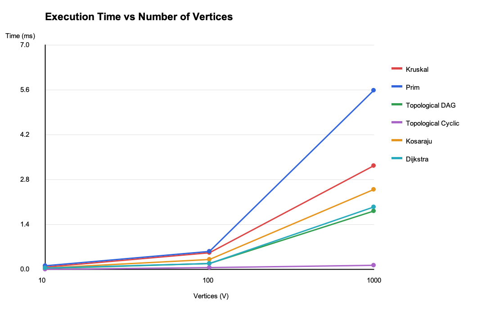

# Assignment 3 — Smart City Infrastructure and Route Planning

## 1. Overview

This project is a Java application that models a smart city infrastructure network using graph data structures and algorithms.

The system supports infrastructure planning, connectivity analysis, and shortest route calculation between city districts.

In this model:

- **Vertices** represent city districts or locations.
- **Edges** represent roads or infrastructure connections.
- **Weights** represent construction costs or travel distances.

The application supports both directed and undirected weighted graphs. Graphs are represented using adjacency lists.

The project implements six graph algorithms and the Disjoint Set Union (DSU) data structure.

## 2. Implementation

### 2.1 Graph Representation

The `Graph` class stores vertices and edges using an adjacency list. The `Edge` class stores the source vertex, destination vertex, and edge weight.

Undirected graphs are used for minimum spanning tree calculations, while directed graphs are used for topological sorting, strongly connected components, and shortest paths.

### 2.2 Disjoint Set Union (DSU)

DSU manages disjoint sets of vertices and determines whether two vertices belong to the same connected component.

Two optimizations are implemented:

- **Path Compression:** Shortens the paths to representative elements during find operations.
- **Union by Size:** Attaches the smaller component to the larger component.

These optimizations provide nearly constant amortized time per operation.

### 2.3 Kruskal's Algorithm

Kruskal's algorithm constructs a minimum spanning tree by sorting edges in ascending order of weight and selecting edges that do not create cycles.

DSU is used to detect whether adding an edge would create a cycle.

The algorithm returns the selected edges, total MST weight, connectivity status, and operation counts.

### 2.4 Prim's Algorithm

Prim's algorithm constructs a minimum spanning tree by expanding the connected set of visited vertices.

The implementation uses a priority queue to select the next minimum-weight edge.

The algorithm also handles disconnected graphs by returning a minimum spanning forest.

### 2.5 Topological Sorting

Topological sorting is implemented using Kahn's algorithm and a priority queue.

It processes vertices according to their incoming edge counts.

A valid ordering is returned for a directed acyclic graph (DAG). If a cycle exists, the algorithm reports that topological ordering is impossible.

### 2.6 Strongly Connected Components

Kosaraju's algorithm identifies strongly connected components in directed graphs.

The implementation performs two depth-first searches:

1. The first DFS determines vertex finishing order.
2. The second DFS processes the reversed graph to identify strongly connected components.

Every vertex belongs to exactly one SCC.

### 2.7 Dijkstra's Algorithm

Dijkstra's algorithm finds the shortest distances from a selected source vertex to all reachable vertices.

The implementation uses a priority queue and stores predecessor vertices to reconstruct shortest paths.

Unreachable vertices are reported separately.

Graphs containing negative edge weights are rejected because Dijkstra's algorithm is not guaranteed to produce correct results with negative weights.

## 3. Complexity Analysis

The algorithms use adjacency lists, and priority-queue implementations use Java's binary-heap-based `PriorityQueue`.

| Algorithm | Time Complexity | Space Complexity |
|---|---|---|
| DSU find / union | O(α(V)) amortized | O(V) |
| Kruskal | O(E log E + Eα(V)) | O(V + E) |
| Prim | O(E log E) | O(V + E) |
| Topological Sort | O(V + E + V log V) | O(V + E) |
| Kosaraju SCC | O(V + E) | O(V + E) |
| Dijkstra | O((V + E) log V) | O(V + E) |

Here, V represents the number of vertices, E represents the number of edges, and α(V) is the inverse Ackermann function.

Kruskal's algorithm spends most of its time sorting edges. Prim's algorithm uses a priority queue to select minimum-weight edges.

The topological sorting implementation uses a priority queue rather than a normal FIFO queue, which introduces additional logarithmic overhead.

Kosaraju performs graph traversals with linear theoretical complexity.

Dijkstra uses priority-queue operations to process vertices according to their shortest known distances.

## 4. Experimental Setup

The experiments evaluate algorithm performance across three graph configurations.

| Graph Size | Vertices | Edges |
|---|---:|---:|
| Small | 10 | 30 |
| Medium | 100 | 500 |
| Large | 1000 | 5000 |

Graph generation uses a fixed random seed of 42 with deterministic adjustments based on graph size and type.

For MST experiments, undirected connected graphs are generated by first connecting every new vertex to an existing vertex, then adding additional random edges.

For directed experiments, DAGs are generated by directing edges from lower-numbered vertices to higher-numbered vertices.

Cyclic directed graphs contain an explicitly created three-vertex directed cycle, followed by additional randomly generated directed edges.

Edge weights are positive integers from 1 to 100.

Each algorithm is executed five times after an initial warm-up execution. Execution time is measured using `System.nanoTime()`.

Average execution time is reported in milliseconds.

Operation counts include algorithm-specific measurements such as edge checks, DSU calls, and priority-queue operations. They are useful for comparing scaling, but are not directly equivalent across different algorithms.

## 5. Experimental Results

### 5.1 Average Execution Time

All values are measured in milliseconds.

| Algorithm | Small | Medium | Large |
|---|---:|---:|---:|
| Kruskal | 0.071575 | 0.526583 | 3.238300 |
| Prim | 0.113400 | 0.562691 | 5.596967 |
| Topological DAG | 0.035217 | 0.194080 | 1.824334 |
| Topological Cyclic | 0.005533 | 0.058042 | 0.128067 |
| Kosaraju SCC | 0.049958 | 0.320250 | 2.492192 |
| Dijkstra | 0.043375 | 0.185917 | 1.952150 |

### 5.2 Operation Counts

| Algorithm | Small | Medium | Large |
|---|---:|---:|---:|
| Kruskal | 76 | 1332 | 12504 |
| Prim | 120 | 2000 | 20000 |
| Topological DAG | 60 | 1000 | 10000 |
| Topological Cyclic | 30 | 528 | 5014 |
| Kosaraju SCC | 90 | 1500 | 15000 |
| Dijkstra | 50 | 758 | 7820 |

The complete experimental data is stored in `results/tables/benchmark.csv`.

### 5.3 Performance Plots

**Execution Time vs. Number of Vertices**

**Execution Time vs. Number of Edges**

Both plots illustrate the increase in execution time as graph size grows.

Because vertex and edge counts increase together in the experimental configurations, these plots show joint scaling rather than the independent effect of vertices or edges.

## 6. Comparison and Discussion

### Kruskal vs. Prim

Both algorithms produced the same minimum spanning tree weight for connected undirected graphs.

In the measured experiments, Kruskal was faster than Prim for all three graph sizes.

On the largest graph, Kruskal required approximately 3.24 ms, while Prim required approximately 5.60 ms.

This difference reflects the implementation and experimental graph structure. It does not imply that Kruskal always outperforms Prim.

Kruskal is suitable when edges can be processed efficiently in sorted order, while Prim is often useful for growing a network from a selected starting point.

### DSU Optimizations

Path compression reduces the depth of parent chains, while union by size prevents unnecessarily tall trees.

Together, they make repeated connectivity checks highly efficient.

### Strongly Connected Components

Kosaraju's measured execution time increased as the graph size increased.

Its theoretical complexity is O(V + E), which makes it appropriate for connectivity analysis on larger directed graphs.

### Topological Sorting

The DAG experiments processed all vertices and edges to produce a valid topological order.

In cyclic graphs, Kahn's algorithm could identify an incomplete ordering without processing the entire graph.

This explains why cyclic graphs showed smaller execution times in these particular experiments.

### Dijkstra

Dijkstra's execution time increased with graph size, while successfully calculating shortest paths from the chosen source.

Performance depends on the reachable portion of the graph and priority-queue operations.

The algorithm is suitable for route planning when edge weights are non-negative.

### Experimental Limitations

The benchmark uses five measured runs per configuration, so results may be affected by JVM optimization, garbage collection, CPU scheduling, and other system activity.

The tested directed graphs are not necessarily fully reachable from the selected Dijkstra source vertex.

For more precise performance comparisons, additional runs, separate warm-up iterations, and a larger range of graph densities would be useful.

## 7. Testing

The application includes eight grouped automated tests covering the required cases.

| Test Case | Result |
|---|---|
| DSU operations | Passed |
| Small graph and MST | Passed |
| Disconnected graph | Passed |
| Multiple MSTs and duplicate weights | Passed |
| Topological ordering and cycle detection | Passed |
| Strongly connected components | Passed |
| Dijkstra and unreachable vertices | Passed |
| Single-vertex graph | Passed |

**Test Summary: 8 Passed, 0 Failed.**

The tests verify MST weights, disconnected graph handling, SCC membership, cycle detection, shortest distances, unreachable vertices, and single-vertex behavior.

Dijkstra is also tested with a negative-weight edge to verify that invalid inputs are rejected.

## 8. Project Structure

    AS3_DAA/
    ├── src/
    │   ├── graph/
    │   │   ├── Edge.java
    │   │   └── Graph.java
    │   ├── dsu/
    │   │   └── DSU.java
    │   ├── mst/
    │   │   ├── KruskalMST.java
    │   │   ├── PrimMST.java
    │   │   └── MSTResult.java
    │   ├── connectivity/
    │   │   ├── KosarajuSCC.java
    │   │   └── TopologicalSort.java
    │   ├── shortestpath/
    │   │   └── Dijkstra.java
    │   ├── experiments/
    │   │   ├── GraphGenerator.java
    │   │   ├── Benchmark.java
    │   │   └── PlotGenerator.java
    │   ├── tests/
    │   │   └── AlgorithmTests.java
    │   └── Main.java
    ├── results/
    │   ├── tables/
    │   │   └── benchmark.csv
    │   └── plots/
    │       ├── time_vs_vertices.png
    │       └── time_vs_edges.png
    └── README.md

## 9. How to Run

The project requires Java JDK 17 or newer.

Open the project in IntelliJ IDEA and execute the following classes:

- `Main.java` — demonstrates the graph algorithms.
- `tests.AlgorithmTests` — executes automated correctness tests.
- `experiments.Benchmark` — measures algorithm performance.
- `experiments.PlotGenerator` — generates two performance plots.

The project uses only standard Java libraries and does not require additional dependencies.

To regenerate matching plots, update the `TIMES` array in `PlotGenerator.java` with the results from the latest benchmark run.

## 10. Conclusion

This assignment demonstrates how graph algorithms can support smart city infrastructure and route planning.

Kruskal and Prim calculate minimum-cost networks connecting city districts. DSU improves cycle detection and connectivity operations.

Topological sorting determines valid dependency orders, and Kosaraju identifies strongly connected components in directed networks.

Dijkstra provides efficient shortest-path calculations when road weights are non-negative.

The experimental results generally demonstrate increased computation time as graph size grows, consistent with the theoretical complexity analysis.

Choosing an appropriate graph algorithm depends on the problem requirements, graph structure, and expected performance.

The project combines algorithm implementation, correctness testing, experimental benchmarking, and complexity analysis in a reproducible Java application.